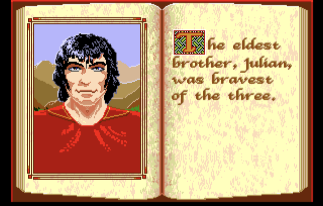
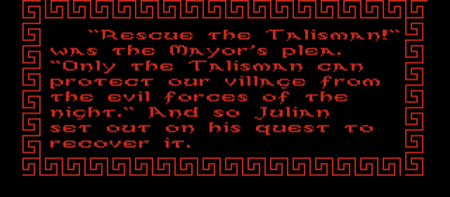
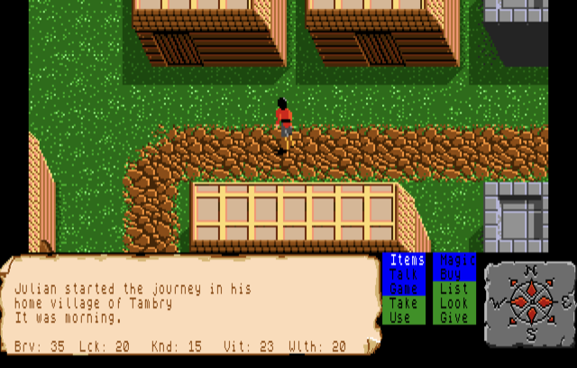
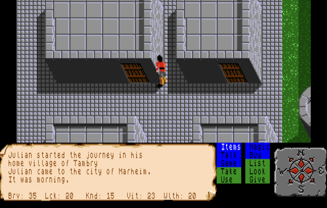
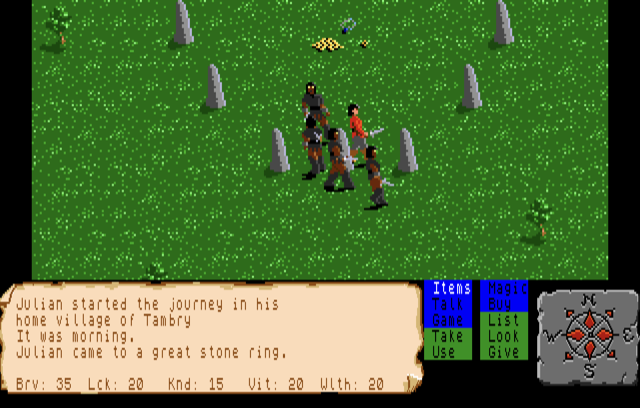
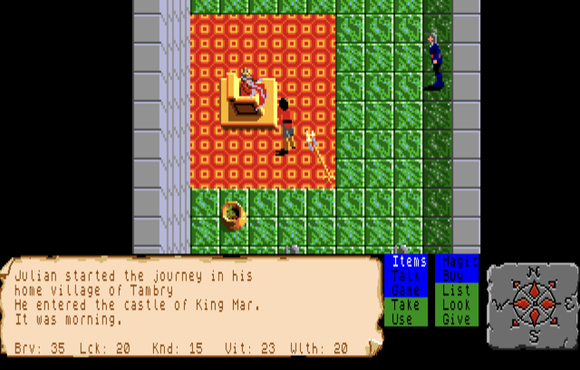
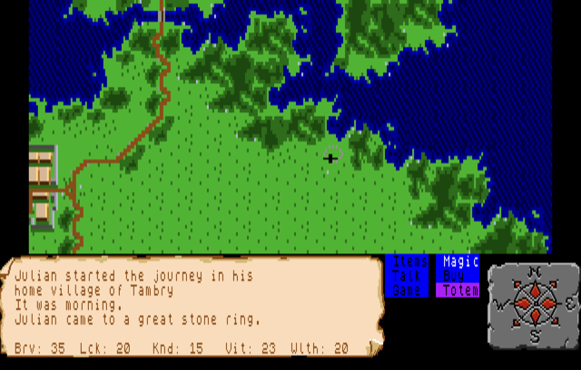

# The Faery Tale Adventure – Amiga original and ZX Spectrum Next port

This repository contains two things side by side:

| Directory | Content |
|---|---|
| [`orig/`](orig) | The original source code and data of *The Faery Tale Adventure*, published by MicroIllusions on the Amiga in 1987, written by David Joiner (Talin). Unchanged; see [`orig/README.md`](orig/README.md) for Talin's notes. |
| [`next/`](next) | A port of the game to the ZX Spectrum Next, built from the original code and data. See [`next/README.md`](next/README.md) for building and playing, and [`next/PORTING.md`](next/PORTING.md) for how the port was done. |

## The Spectrum Next port in short

- The game logic of the original is ported to C, largely line by line.
- Graphics, sound, input and file access are rewritten for the Next's hardware: Layer 2
  with hardware scrolling, hardware sprites, the status panel as a tilemap, music on the
  AY chips, sound effects through the DAC.
- The game data is converted at build time from the original disk image in `orig/game`.
- Builds as a single `fta.nex` for a Next with 2 MB, or as `fta.nex` plus a data folder
  for 1 MB.

### Screenshots (ZX Spectrum Next, in CSpect)

| | |
|---|---|
|  |  |
| The intro: the book of the three brothers | A placard in the game's own Amber font |
|  |  |
| Julian sets out from Tambry | The city of Marheim |
|  |  |
| A band of ogres at the stone ring | The throne room of King Mar |
|  | |
| The magic map of the bird totem | |

Building needs [z88dk](https://z88dk.org) and Python 3:

```
cd next
make -j8
```

The port was written by Claude, Anthropic's AI model, on behalf of the owner of this
repository, who tested it and steered the work. [`next/PORTING.md`](next/PORTING.md)
tells the story.

## Copyright

Talin's statement on the copyright of the original code is in
[`orig/README.md`](orig/README.md): he makes whatever rights he has available under an
MIT-style permissive license, while the status of the rights held by the publisher's
successors is unclear. The same applies to the game data the port converts.

## Other forks

Talin's README lists further forks of the original code, among them an SDL port and a
reverse engineering research branch.
